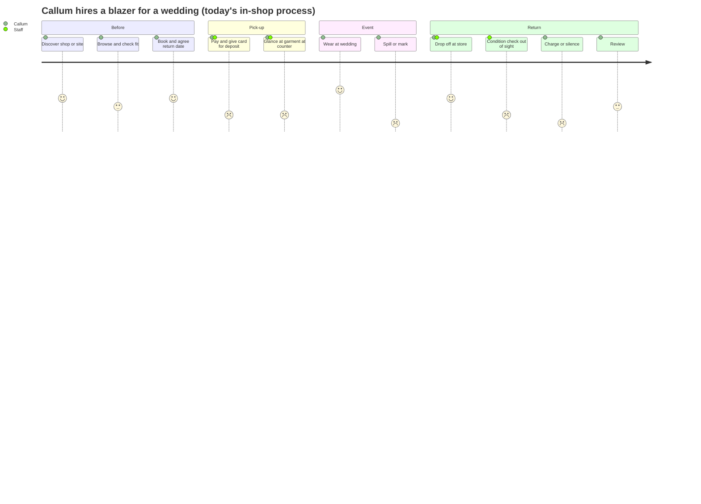
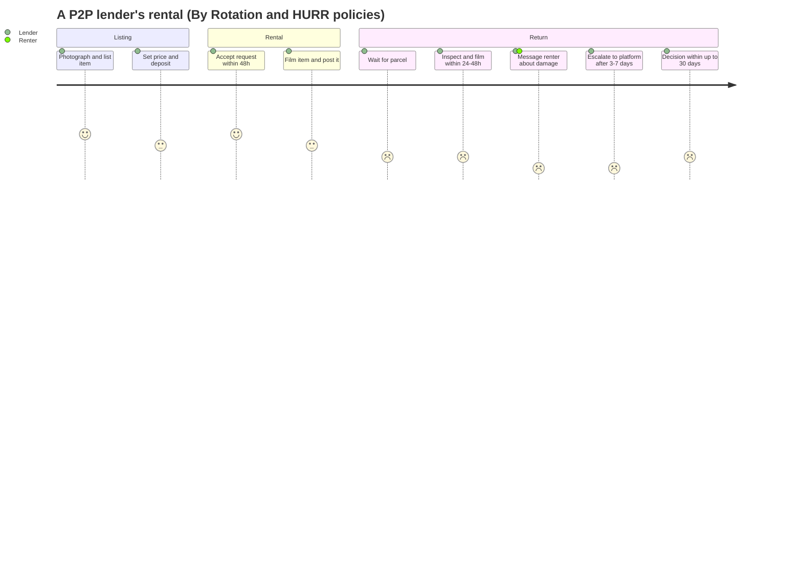
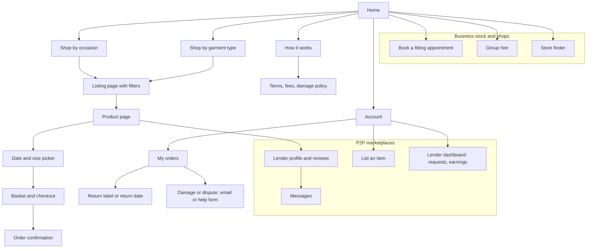
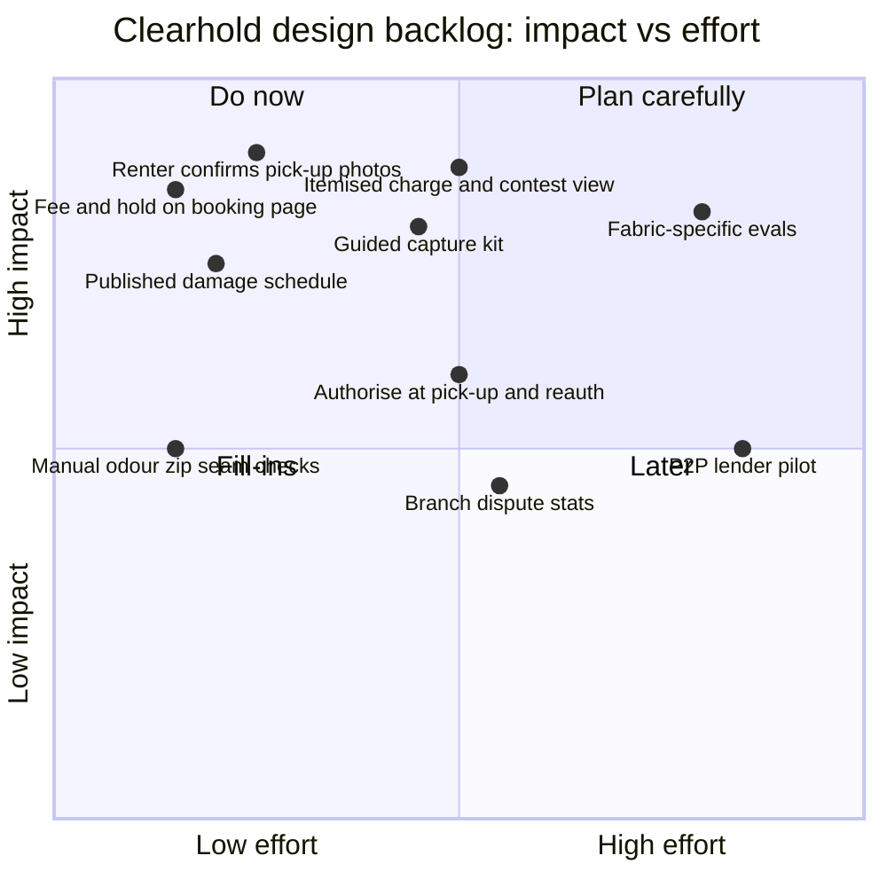

# Clearhold: UK clothing hire research

Oct 31, 2026 · @Ruona

UK clothing hire already takes deposits, but nobody shows the renter the evidence. Clearhold's shared photos, published damage bands and one contest route fill a gap every platform we checked leaves open.

**Scope and method.** Clearhold-first: formalwear and occasionwear hire (in-shop and online), with peer-to-peer (P2P) rental as context. Sources are platform help centres and terms, an 80-review Trustpilot sample coded by hand, academic papers, CMA guidance and PayPal docs. We could not create accounts, so checkout and lender listing flows were not walked through; those parts are marked \[INFERENCE\] or \[UNVERIFIED\]. Labels: **\[FACT\]** sourced, **\[INFERENCE\]** our reasoning, **\[UNVERIFIED\]** plausible but not confirmed.

## 1. Executive summary

### Ten findings

| # | Finding | Implication for Clearhold |
| --- | --- | --- |
| 1 | **Shops hold a card, not a deposit.** Moss takes card details through a £1.01 transaction refunded at once, which authorises charges of up to £450 for loss, damage or non-return \[FACT\] ([Moss, accessed 31 Oct 2026](https://www.mossbroshire.co.uk/terms-and-conditions/security-deposit)). | A real authorisation hold is more honest but more visible. Explain it at booking, or it reads worse than "no money taken". |
| 2 | **Damage standards are binary.** Moss charges £20 for a repairable spill or repair; bodily fluid or "excessive" stains count as beyond repair and cost the full selling price \[FACT\] ([Moss](https://www.mossbroshire.co.uk/terms-and-conditions/damaged-items)). No platform publishes a wear-versus-damage list \[FACT: none found\]. | Clause bands plus "wear is never charged" are a genuine differentiator. Publish the schedule before checkout. |
| 3 | **Evidence is the user's job.** By Rotation tells lenders to film the item before posting and on return \[FACT\]; HURR lenders must report damage with photos within 48 hours \[FACT\]; MWHQ writes its own condition report on return \[FACT\]. | Structured photos at both ends, visible to both sides, is the core product. Nobody does it. |
| 4 | **Disputes end with the platform's word.** By Rotation's mediated decision is final and can take up to 30 days \[FACT\]; HURR's team sets market value and HURR carries no liability \[FACT\]. | One evidence-based contest, decided by a named person, is a visible fairness signal. |
| 5 | **Protection products are small and capped.** HURR Damage Protection covers repairs up to £75 \[FACT\]; Moss Peace of Mind is £9.95 per outfit \[FACT\]; Rent the Runway (US) bundles minor damage into the subscription \[FACT, US\]. | A £24 stain charge from a published band competes with waivers on clarity. Never pre-tick a waiver. |
| 6 | **Damage, condition and loss lead P2P complaints.** In 40 By Rotation reviews (Mar–Aug 2026), 9 of 17 complaints were about condition on arrival, damage after return or loss \[FACT: our coding\]. | Pick-up photos protect the renter as much as the business. Sell both sides of that. |
| 7 | **Hygiene is a proven barrier.** A study of 566 rental reviews found contamination incidents, mostly visual and odour, and some led customers to reject rental entirely \[FACT, 2020, older source\]. | Pick-up photos double as a cleanliness promise. Add a manual odour check: a camera cannot smell. |
| 8 | **UK rental is still niche.** 4% of UK consumers currently rent clothing, against 27% of high-frequency shoppers \[FACT\] ([QSA Partners, June 2025](https://www.icaro.uk.com/news/2025/weekend-wearer)). | Sell to businesses that already hire at volume (formalwear shops), not on consumer rental growth. |
| 9 | **Online platforms are consolidating and pivoting.** Rotaro is now part of MWHQ \[FACT\]; Hirestreet moved to a £75-a-month subscription with no date-specific bookings \[FACT\]; HURR now runs rental for John Lewis, Selfridges and Deliveroo \[FACT\]. | Date-specific occasion hire is drifting back to shops and P2P, which is Clearhold's ground. |
| 10 | **Fees are a legal and UX risk.** CMA guidance (18 Nov 2025) requires mandatory fees in the headline price, with first cases on drip pricing and default opt-ins \[FACT\]. Renters complain of a 15% service fee and tracked postage \[FACT\]. | Show hire fee, deposit hold and total on the product page, not at checkout. |

### Three biggest opportunities

1. **Independent formalwear shops** run Moss-style terms with no evidence trail \[INFERENCE\]. Clearhold gives them a fair, defensible process without building it.
2. **Renter-side protection.** Pick-up photos prove pre-existing marks. That speaks to the most common P2P complaint (condition on arrival) \[INFERENCE\].
3. **Replace flat waivers with a published schedule and fast release.** A clean return released in minutes beats a £9.95 waiver on both price and trust \[INFERENCE\].

### Three biggest risks

1. **Wrong AI calls on fabric.** Sheen, sequins, lighting and colour shift can look like stains. One wrongful charge undoes the fairness story \[INFERENCE\].
2. **Hold mechanics.** PayPal holds last 29 days with a 3-day honour period \[FACT\]. A booking taken weeks before a wedding cannot hold the deposit until return \[INFERENCE\].
3. **Regulation.** A term letting the trader alone decide damage may be challenged as unfair under the Consumer Rights Act 2015 \[INFERENCE: needs legal review\]. Drip pricing is now directly enforceable \[FACT\].

## 2. Market map

The only UK player we found taking a real deposit up front is HURR, and that is set by each lender. Shops keep a card on file. Managed platforms fold minor damage into the price. All policies below were read on 31 Oct 2026 unless dated otherwise.

| Platform | Model | Status | Price signal | Deposit approach | Damage and late return | Logistics | Cleaning | Channel |
| --- | --- | --- | --- | --- | --- | --- | --- | --- |
| [Moss Hire](https://www.mossbroshire.co.uk/terms-and-conditions/fee-list) | Business stock, menswear formalwear | Trading \[FACT\] | Not checked | Card authority up to £450, set up by a £1.01 refunded transaction \[FACT\] | £20 repair or spillage; full selling price if beyond repair; £10 a day late; card charged if not back within 7 days \[FACT\]. Optional Peace of Mind £9.95 \[FACT\] | Store collection and return; DPD courier £8–£20; courier return £10 \[FACT\] | Not stated | Web and stores |
| [Walters of Oxford](https://www.walters-oxford.co.uk/conditions-of-hire/) | Independent shop, business stock | Trading \[UNVERIFIED\] | Replacement list from £25 (shirt) to £80 (suit) \[FACT, page undated\] | None if paying by card; cash needs ID and may need a deposit \[FACT\] | Return next working day; 50% extra per week \[FACT\] | In person | Shirt laundering included \[FACT\] | Web and shop |
| [By Rotation](https://faq.byrotation.com/hc/en-gb/articles/9178171415453-Theft-or-Damage) | P2P | Trading; Uber courier added Jan 2026 \[FACT\] | Lender sets price; 15% service fee \[FACT, company reply on Trustpilot\] | None found \[UNVERIFIED\] | Repair reimbursed; replacement or market value if beyond repair or lost; mediated decision final \[FACT\] | Post, local pick-up (about 30% of rentals), Uber courier \[FACT\] | Optional dry-cleaning fee set by lender \[FACT, older source\] | App first, web |
| [HURR](https://help.hurrcollective.com/en/article/5757a3-security-deposits) | Hybrid: P2P plus brand and retailer rental | Trading; B2B partnerships \[FACT\] | Not checked | Lender-set security deposit, typically 20% of RRP, charged up front and released on safe return \[FACT\] | Optional Damage Protection covers repairs to £75; above that, renter pays market value set by HURR \[FACT\] | Post, hand delivery, Deliveroo on-demand \[FACT\] | Lender dry-cleans and prices it \[FACT\] | Web and app |
| [Hirestreet](https://www.hirestreetuk.com/pages/topfaqs) | Business stock (brand surplus) plus rental for brands | Trading; pivoted to subscription \[FACT\] | 5 items £45/month for 2 months, then £75 \[FACT\] | None found \[UNVERIFIED\] | Accidental damage included in subscription; one-off orders pay extra \[FACT\]. Unreturned items: buy links, account may be cancelled \[FACT\] | Evri post, 48h tracked \[FACT\] | Included \[FACT\] | Web (Shopify) \[FACT\] |
| [MY WARDROBE HQ](https://mywardrobehq.com/how-it-works) | Managed marketplace (vendor-owned stock it handles) | Trading; absorbed Rotaro \[FACT\] | Not checked | None found; ID check before first rental \[FACT\] | Included insurance for minor wear; return condition report may lead to a part or full charge \[FACT\]. £8 restock fee (£40 bridal) \[FACT\] | DPD post, 4–14 days \[FACT\] | Free dry cleaning \[FACT\] | Web |
| The Volte | P2P (Australian, eBay-backed) | Launched in UK in H1 2025 \[FACT\] ([Circular Fashion News](https://circularfashionnews.substack.com/p/fashion-rental-report-q1q2-2025)) | Not checked | Not checked | Not checked | Not checked | Not checked | Not checked |
| **US benchmark:** [Rent the Runway](https://renttherunway.com/plans) | Business stock, subscription | Trading \[FACT\] | Not checked | None | Subscription covers minor mishaps and wear; significant damage, loss or theft charged at RTR purchase price plus tax \[FACT, US\] | Post | Included | Web and app |
| **US benchmark:** [Pickle](https://help.shoponpickle.com/en/articles/14435406-condition-reporting-renter) | P2P | Trading \[FACT\] | Not checked | Not checked | Renter condition photos required for any refund claim \[FACT, US\] | Post, local | Owner cleans between rentals \[FACT, US\] | App |

### Closed and pivoted platforms

- **Rotaro → MY WARDROBE HQ.** Rotaro, a Gen Z rental site, first pooled stock with MWHQ and now redirects to it \[FACT\] ([Apparel Resources](https://apparelresources.com/business-news/retail/rental-platforms-wardrobe-hq-rotaro-consolidate-stock-wider-consumer-choice/); [Autotouch listing](https://www.autotouch.ai/prospecting/rotaro)). *Lesson:* small rental catalogues struggle to stand alone; shared stock and back office win \[INFERENCE\].
- **Hirestreet: occasion hire → subscription.** It now sells a monthly box and says it does not take bookings for specific future dates; it advises ordering 5–7 days before an event \[FACT\]. *Lesson:* date-specific occasion hire is costly to run by post (idle stock, delivery risk) \[INFERENCE\]. That leaves room for shops and local P2P.
- **HURR: P2P marketplace → rental-as-a-service.** It now runs rental for department stores, Mulberry and Deliveroo \[FACT\] ([CB Insights, Oct 2026](https://www.cbinsights.com/investor/hurr)). *Lesson:* B2B revenue is steadier than P2P take rates \[INFERENCE\].
- **Onloan (closed, Feb 2022).** It paused, citing the pandemic, HMRC rules on leasing, and stock problems \[FACT, older source\] ([TheIndustry.fashion](https://www.theindustry.fashion/clothing-rental-platform-onloan-pausing-operations/)). *Lesson:* tax treatment of hire and stock cost can sink a model; check VAT treatment of deposits early \[INFERENCE\].
- **Style Theory (Singapore, closed Oct 2025, non-UK).** It shut abruptly, citing rising costs and investor exit, and asked customers to return rented bags \[FACT\] ([Mothership](https://mothership.sg/2025/10/style-theory-clothes-rental-app/)). *Lesson:* when a rental firm fails, deposits and items in transit are stranded. A hold that expires by itself is safer for renters than a held cash deposit \[INFERENCE\].

## 3. Behavioural patterns

People hire for a dated event and fear two moments most: the item arriving wrong, and the bill after return. Personas below are built from the review sample, platform policies and the cited research; they are \[INFERENCE\] unless a line says otherwise.

### Renter personas

| Persona | Motivation | Trigger | Barriers | Frequency and spend |
| --- | --- | --- | --- | --- |
| **The wedding guest** (most common voice in reviews) | Save money on a one-off outfit; avoid being photographed twice in the same dress \[FACT: stated in reviews\] | Invitation; Christmas party | Arrival timing, fit, condition on arrival, return postage | A few times a year; fee plus tracked return post (one reviewer paid £20 insured postage) \[FACT\] |
| **The formalwear hirer** (Callum) | Needs black tie, morning dress or a matching group outfit once | Wedding party, prom, races | Fit, fear of a stain bill, deposit uncertainty. 23% of Brits feared damaging rented clothes \[FACT, VoucherCodes 2021, older\] | One to three hires a year; mostly in store \[INFERENCE\] |
| **The group organiser** | Groom or best man booking several outfits | Wedding date set months ahead | Coordinating fittings; one card exposed for many outfits | One large order; Moss deposit is per order \[FACT\] |
| **The rotator** | Variety for work and weekends without owning | Monthly | Subscription cost ("just too much for me currently", Hirestreet review) \[FACT\] | Monthly; £45–£75 at Hirestreet \[FACT\] |

### Lender and operator personas

| Persona | Why they lend | What they fear | How they manage |
| --- | --- | --- | --- |
| **Side-income lender** (P2P) | Pocket money and community; one lender described her dresses as having a social life \[FACT\] | Late or rude renters, unpaid postage | Lender sets price and minimum period \[FACT\]; accepts or rejects each request \[FACT\] |
| **High-value lender** (P2P) | Earn back the cost of designer pieces | Theft and loss: reviews describe an £825 dress lost in the post and a £3,000 item stolen, both left uncompensated \[FACT\] | Deposits where the platform allows (HURR, 20% of RRP) \[FACT\]; videos before and after \[FACT\] |
| **Branch lead** (Priya, Ledgerton) | Protect stock without arguing with customers | Being unable to prove when a mark appeared; staff time; bad reviews | Today: eyeball the garment at the counter and decide \[INFERENCE\] |

### Jobs to be done

- **Wedding guest:** when I have an event, help me look new in photos without buying, so I can spend the money on the day.
- **Formalwear hirer:** when I pick up a suit, let me see what state it is in, so I am not blamed for marks I did not make.
- **Group organiser:** when I book for six people, let me know each person's exposure, so no one gets a surprise bill.
- **Lender:** when my item comes back, let me prove what changed, so I get paid without a fight.
- **Branch lead:** when a garment returns, tell me quickly what is new damage and what it costs under our terms, so I can release clean returns and defend real charges.

### Journey map: renter (Callum, in-shop formalwear, today)

Scores run from 1 (painful) to 5 (good). They are \[INFERENCE\] from Moss terms and review themes.

| Stage | Thinking | Pain point | Drop-off risk |
| --- | --- | --- | --- |
| Book | "What will this really cost?" | Fee shown; deposit amount and damage rules buried in terms \[INFERENCE\] | Medium |
| Pick-up | "Is this mark already here?" | No shared record of condition \[INFERENCE\] | Low (already committed) |
| Event | "If I spill wine, what happens?" | Binary rule: £20 or full price \[FACT\] | n/a |
| Return | "Will they charge me?" | Check happens without the renter; result arrives later or not at all \[INFERENCE\] | High for repeat use |
| Refund or charge | "Why this amount?" | No itemised evidence found in any UK policy \[FACT: none found\] | High; review risk |

### Journey map: lender (P2P)

The 48-hour accept window, the 24–48 hour damage report and the 7-day and 30-day dispute clocks come from HURR and By Rotation help pages \[FACT\].

### Trust and anxiety: what reviews complain about

We coded 80 recent Trustpilot reviews by hand: 40 By Rotation, 20 HURR, 20 Hirestreet. 25 raised a problem. This is a small, self-selected sample, so use it for direction, not rates.

| Theme | By Rotation | HURR | Hirestreet | Total |
| --- | --- | --- | --- | --- |
| Late or failed delivery for the event | 2 | 1 | 1 | 4 |
| Condition on arrival (dirty, ripped, missing part) | 4 | 0 | 0 | 4 |
| Damage dispute or charge after return | 3 | 0 | 0 | 3 |
| Loss, theft or non-return (lender side) | 2 | 1 | 0 | 3 |
| Fees and return postage | 1 | 1 | 0 | 2 |
| Fit, with no partial refund | 1 | 0 | 1 | 2 |
| App bugs | 2 | 0 | 0 | 2 |
| Lender cancelled | 1 | 0 | 0 | 1 |
| Other (pick-up timing, return emails, filters, sustainability claim) | 1 | 1 | 2 | 4 |
| **Complaints / reviews sampled** | **17 / 40** | **4 / 20** | **4 / 20** | **25 / 80** |

Condition, damage and loss together make up 10 of 25 complaints \[FACT: our coding\]. One By Rotation renter called P2P hire "an expensive risk to take for important events" ([Trustpilot, May 2026](https://uk.trustpilot.com/review/www.byrotation.com?page=4)).

Hygiene sits under the surface. Clube and Tennant found contamination incidents, mostly visual and odour, in 566 reviews of two rental providers \[FACT, 2020, older\] ([abstract](https://zendy.io/title/10.1002/cb.1817)). Baek and Oh found contamination concern weakens the link between liking rental and actually renting \[FACT, 2021, older\] ([PMC](https://pmc.ncbi.nlm.nih.gov/articles/PMC7538377)).

### Post-rental behaviour

- **Loyalty credits:** HURR returns 5% of each rental as credit \[FACT\] ([HURR](https://about.hurrcollective.com/how-it-works)); Hirestreet runs points and rewards feedback \[FACT: per a 2026 review\].
- **Renting to lending:** By Rotation and HURR let one account do both \[FACT\]. No figures on how many switch were found.
- **Repeat and churn rates:** no public data found for any UK platform. Reviews suggest a single bad dispute ends use ("first and last time") \[FACT: several reviews\].

## 4. Site structure and architecture

Shop sites are built around occasions and appointments; P2P apps are built around people and messaging. Neither has a page for the condition record, which is where Clearhold slots in. We read public navigation and help centres; we did not complete bookings.

### Typical sitemap

The key difference: in shops, damage is handled at the counter and in terms pages; in P2P apps, it is pushed into messages between users, with the platform as a last resort \[FACT: Moss terms; By Rotation and HURR help pages\].

### Navigation and filters

| Facet | Shops (e.g. Moss) | Online stock (e.g. Hirestreet) | P2P (By Rotation, HURR) |
| --- | --- | --- | --- |
| Occasion | Weddings, black tie, race day, prom \[FACT\] | Wedding guest, black tie, party, workday \[FACT\] | Present \[UNVERIFIED\] |
| Garment type | Suits, tuxedos, morning tails, kilts \[FACT\] | Dresses, tops, coats and more \[FACT\] | Present \[FACT: app store text\] |
| Size and fit | Size guide; in-store measuring \[FACT\] | No try-on; stylist chat \[FACT\] | Colour, size, brand, style filters \[FACT\] |
| Dates | Return date agreed at booking \[FACT\] | No future-date booking \[FACT\] | Lender sets minimum period \[FACT\] |
| Location and collection | Store finder, courier \[FACT\] | Post only \[FACT\] | Local pick-up or post \[FACT\] |

Availability filtering by date was not visible on any site we read \[UNVERIFIED: needs a logged-in walkthrough\].

### Key page templates

Best and worst examples are judged from public pages and policies only.

| Page | Common pattern | Best found | Worst found |
| --- | --- | --- | --- |
| Product page | Photos, rental price, RRP, size | Hirestreet shows rent price beside RRP and buy-now price \[FACT\] | Deposit and damage rules absent from product pages we read \[INFERENCE\] |
| Date and availability picker | Calendar of rental start | Moss agrees a return date at booking \[FACT\] | Hirestreet cannot book a future date, which is a poor fit for events \[FACT\] |
| Basket and checkout | Fee, delivery, protection add-on | Optional protection kept optional (Moss, HURR) \[FACT\] | 15% service fee and 30% admin fee on a damage settlement both surprised reviewers \[FACT\] |
| Return flow | Label or store drop | Hirestreet digital label and QR at Evri \[FACT\] | P2P renter pays tracked return post \[FACT\] |
| Damage and dispute | Email support after peer talks fail | By Rotation publishes clocks: 24h, 7 days, 48h reply, up to 30 days \[FACT\] | No itemised evidence shown to renter on any platform \[FACT: none found\] |
| Lender listing flow | Photos, category, description | By Rotation "under a minute" upload \[FACT: app store\] | Condition record left to lender videos \[FACT\] |
| Lender dashboard | Requests, earnings | Accept or reject within 48h (HURR) \[FACT\] | Not reviewed |

### App versus web

- By Rotation is app-first and calls its app proprietary rather than a web wrapper \[FACT\] ([TechCrunch](https://techcrunch.com/?p=2291520)). Android glitches appear in reviews \[FACT\].
- Moss, Hirestreet and MWHQ are web-led \[FACT\].
- &#91;INFERENCE\] Pick-up and return evidence is a phone-camera job for staff, while renters read results on whatever device they booked on. Clearhold should be mobile web for both, not a native app.

### Under the hood

| Item | What we found | Label |
| --- | --- | --- |
| Hirestreet | Shopify storefront ("Powered by Shopify" footer) | \[FACT\] |
| Moss Hire | Site meta names remarkable.net as author; help centre on Freshdesk | \[FACT\] |
| HURR help | Dixa knowledge base | \[FACT: CDN path\] |
| By Rotation help | faq.byrotation.com/hc path suggests Zendesk | \[INFERENCE\] |
| Deposits | Moss: card-on-file authority; HURR: up-front charge, later released | \[FACT\] |
| ID checks | MWHQ and HURR verify identity before renting | \[FACT\] |

**Core data entities** \[INFERENCE\]: item (garment), listing, availability calendar, booking, payment authorisation, condition record (photos per angle, per visit), claim, contest, review. No platform exposes a condition record as a first-class object today.

## 5. The psychology behind the design

Loss aversion around the deposit is the strongest force in hire, and every platform manages it with insurance-style add-ons rather than evidence. The "evidence it works" column cites general research where rental-specific studies do not exist; that transfer is \[INFERENCE\].

| Principle | Where it shows up in clothing hire | Evidence it works | How it is misused | Ethical version (for Clearhold) |
| --- | --- | --- | --- | --- |
| **Trust signals and social proof** | Lender reviews, response rates, verified badges (By Rotation "green tick") \[FACT\]; ID checks (HURR, MWHQ) \[FACT\] | By Rotation points renters to lender response rates when deliveries fail \[FACT\] | Unverified or incentivised reviews shown as organic | Show branch-level dispute stats ("92% released in full") once real; label any rewarded review |
| **Anchoring** | Rent price next to RRP and a "SAVE 70%" badge (Hirestreet) \[FACT\] | Price anchoring is well established in pricing research \[INFERENCE: not rental-specific\] | Inflated or stale RRPs; damage charged at full RRP on a much-worn item | Anchor the deposit to the damage schedule, not to RRP: "Most returns cost £0" |
| **Scarcity and urgency** | Event dates; limited sizes; promo countdowns | CMA's first DMCC cases include misleading countdown timers \[FACT\] | Fake "only 1 left for your date" | Show real availability only; no timers on deposits |
| **Loss aversion and deposits** | £450 card authority (Moss) \[FACT\]; 20% RRP deposit (HURR) \[FACT\]; waiver up-sells | 23% of Brits feared damaging rented clothes \[FACT, 2021, older\] | Waivers sold on fear of a full-price charge that the terms make likely | Cap exposure per band; show the worst case in pounds; release clean returns in minutes |
| **Choice overload and filtering** | 50,000+ items on By Rotation \[FACT\]; a review asked Hirestreet for better filters \[FACT\] | Filtering reduces effort on large catalogues \[INFERENCE\] | Endless feeds tuned for engagement, not fit | For shops, a small curated rail by occasion and size |
| **Endowment and reciprocity (P2P)** | Lenders value their pieces above market; community framing ("#WhatsMineIsYours") \[FACT: app text\] | Lender reviews describe emotional attachment and anger at loss \[FACT\] | Guilt used to settle disputes in the lender's favour | Price damage from a neutral schedule, not the owner's feelings |
| **Identity and community** | Sustainability and wardrobe-sharing language across all platforms \[FACT\] | Green, functional and emotional values drive rental intent \[FACT, Baek and Oh 2021, older\] | Greenwashing: one review challenged Hirestreet's sustainability claim \[FACT\] | Make claims specific and checkable ("this blazer has been worn 14 times") |
| **Risk reversal** | Damage Protection to £75 (HURR), Peace of Mind £9.95 (Moss), included cover (Hirestreet, MWHQ, RTR) \[FACT\] | Common across hire markets \[INFERENCE\] | Cover sold that excludes the likely risks (Moss excludes loss and some items) \[FACT\] | "You only pay for new damage we can show you" as the default, not an add-on |
| **Default effects** | Protection add-ons at checkout | CMA is investigating default opt-ins for add-ons \[FACT\] | Pre-ticked protection | Nothing pre-ticked; the hold is explained, not upsold |

## 6. Good and bad practice

Every platform is weakest on dispute fairness, scoring 2 or 3 out of 5. Scores are our judgement from published policies and the review sample \[INFERENCE\]. Availability, fit, accessibility and mobile were not tested hands-on, so they are left out rather than guessed.

### Heuristic scorecard (1 = poor, 5 = strong)

| Platform | Fee transparency | Deposit and damage clarity | Return ease | Dispute fairness | Why, in one line |
| --- | --- | --- | --- | --- | --- |
| Moss Hire | 4 | 3 | 4 | 2 | Full public fee list; but the damage rule is binary and no appeal route is published |
| Hirestreet | 4 | 4 | 4 | 3 | Damage cover and cleaning included in the subscription; disputes rarely arise |
| MY WARDROBE HQ | 3 | 3 | 4 | 2 | Minor wear insured; charges follow MWHQ's own condition report, which renters do not see |
| HURR | 3 | 3 | 3 | 2 | Deposit and £75 cap published; HURR sets market value and accepts no liability |
| By Rotation | 2 | 2 | 2 | 2 | 15% fee and damage add-ons surprise renters; mediated decision is final |

**Lender tools (P2P only):** both HURR and By Rotation let lenders approve each request and set prices \[FACT\]. HURR adds lender-set deposits and HURR PROTECT (£3–£10) \[FACT\]; By Rotation relies on lender videos \[FACT\].

### Best practices

1. **Publish a full fee list.** Moss lists every fee, from late return to cancellation, on one page \[FACT\]. Renters can price the worst case.
2. **Bound the deposit.** Moss states a £450 ceiling \[FACT\]. A known maximum reduces fear more than a vague "we may charge".
3. **Keep protection optional.** Moss and HURR sell cover as an add-on, not pre-ticked \[FACT\]. This stays clear of CMA's default opt-in concern.
4. **Fold minor damage into the price.** Hirestreet, MWHQ and Rent the Runway (US) include cover for minor wear \[FACT\]. Renters stop worrying about small marks.
5. **Publish dispute clocks.** By Rotation states 24 hours, 7 days, a 48-hour reply and up to 30 days \[FACT\]. People know when to act.
6. **Ask for evidence at both ends.** By Rotation's checklist (flat or on a hanger, several angles, neutral background, film every flaw) is sound \[FACT\].
7. **Require arrival photos for renter claims.** Pickle (US) will not consider a refund without condition photos \[FACT, US\]. It makes claims comparable.
8. **Verify identity before hire.** HURR and MWHQ check ID \[FACT\]. That deters theft, the costliest lender loss.
9. **Same-day return for a faulty item.** By Rotation refunds in full if a faulty item goes back the same day \[FACT\]. Clear, though see bad practice 6.
10. **Digital return labels.** Hirestreet generates a QR at the parcel shop \[FACT\]. Less paper, fewer lost labels.
11. **Buy-to-keep after damage.** MWHQ and Hirestreet let renters buy the item \[FACT\]. Turns a damage row into a sale.
12. **Fast channels for urgent fixes.** Hirestreet answers on WhatsApp and email and ships replacements next day \[FACT: review\].

### Bad practices and dark patterns

| Practice | Example | UK rule it may engage |
| --- | --- | --- |
| **Hidden or drip-fed fees** | A renter found a 30% admin fee added to an agreed damage settlement; By Rotation said its fee is 15% and offered to review \[FACT, Apr 2026\] | DMCC Act 2024 drip-pricing ban; CMA price transparency guidance, 18 Nov 2025 \[FACT\] |
| **Unclear damage standards** | "Excessive stains" equals beyond repair and full selling price (Moss) \[FACT\]; no UK platform defines normal wear | Consumer Rights Act 2015 Part 2: terms must be transparent and fair \[INFERENCE: legal review\] |
| **One-sided decisions** | By Rotation: mediated decision final; HURR: team sets market value \[FACT\] | CRA 2015 Sch 2 grey list covers terms giving the trader sole right to interpret the contract \[INFERENCE: legal review\] |
| **Full RRP for a worn garment** | Beyond-repair charge at current selling price (Moss), RTR purchase price (US) \[FACT\] | Possible penalty or unfair term if it exceeds actual loss \[INFERENCE\] |
| **Slow resolution** | Up to 30 days (By Rotation) \[FACT\]; a lender lost a £200 dress after missing a grace window \[FACT: review\] | CRA 2015 services: reasonable time and care \[INFERENCE\] |
| **All-or-nothing refunds** | Full refund only if the faulty dress goes back the same day; no partial refund when worn for the event \[FACT: review and reply\] | CRA 2015 goods hire remedies may allow price reduction \[INFERENCE: legal review\] |
| **Cancellation friction** | Moss keeps the whole order value if cancelled within 31 days \[FACT\] | Fair if disclosed and reflects loss; cancellation rights for distance hire need checking \[UNVERIFIED\] |
| **Subscription exit conditions** | Hirestreet requires all items back before you can pause or cancel; billing continues meanwhile \[FACT\] | DMCC subscription regime starts January 2027 \[FACT\] ([Stephenson Harwood, Aug 2026](https://shlegal.com/insights/subscription-reforms-brought-forward-to-january-2027-is-your-business-ready/)) |
| **Rewarded reviews** | A reviewer said Hirestreet rewards feedback \[FACT\] | DMCC Sch 20 bans concealed incentivised reviews \[INFERENCE: depends on disclosure\] |
| **Fake urgency** | Not observed in this sample | DMCC banned practices; CMA countdown timer cases \[FACT\] |

### Accessibility (WCAG 2.2) risks

We did not run an audit. These are the usual failure points for this page type \[INFERENCE\]:

- **Date pickers:** not keyboard-operable (2.1.1); focus hidden behind sticky headers (2.4.11); day cells smaller than 24 × 24 px (2.5.8); no typed-date alternative.
- **Image-heavy product pages:** missing alt text on detail shots (1.1.1); zoom that traps focus; colour names given only as swatches.
- **Filters:** custom checkboxes without names or states (4.1.2); results update with no announcement (4.1.3).
- **Camera capture (Clearhold's own risk):** guided photo steps must have text instructions, a manual upload route and no time limits (2.2.1).

## 7. Deep dive: deposits, damage and disputes

No UK platform records condition in a form both sides can see, and none defines normal wear. That is the gap Clearhold is built for; the risk is that clothing is harder to read from photos than tools are.

### How each platform handles condition, damage and disputes

| Platform | Condition at dispatch | Condition at return | Who decides | Wear vs damage standard | Costs and caps | Cleaning and damage | Dispute route and clock |
| --- | --- | --- | --- | --- | --- | --- | --- |
| Moss Hire | Customer does "final checks" in store at collection, framed around packaging \[FACT\]; no photo record found | Staff check \[INFERENCE\] | Moss | Repairable vs beyond repair; bodily fluid or excessive stains = beyond repair \[FACT\] | £20 repair or spill; full selling price beyond repair; up to £450 on card \[FACT\] | Spillage charged as £20 unless Peace of Mind bought \[FACT\] | None published \[FACT: none found\] |
| By Rotation | Lender videos before posting \[FACT\] | Lender videos on return day; damage reported same day \[FACT\] | Lender and renter first; By Rotation if no deal in 7 days; decision final \[FACT\] | None defined | Repair cost; market value if beyond repair or lost; 15% fee on invoices \[FACT\] | Lender may charge an optional dry-cleaning fee \[FACT, older\] | Same day → 7 days → 48h reply → up to 30 days \[FACT\] |
| HURR | Lender's own photos \[INFERENCE\] | Lender inspects; reports within 48h with photos \[FACT\] | Lender and renter; HURR after 72h; HURR team sets value \[FACT\] | Protection list: zips, clasps, beads, minor stains \[FACT\] | Deposit about 20% of RRP; protection to £75; above it, market value \[FACT\] | Lender dry-cleans between rentals \[FACT\] | 48h report → 72h talks → HURR care team \[FACT\] |
| MY WARDROBE HQ | Managed; "pristine" promise \[FACT\] | MWHQ condition report \[FACT\] | MWHQ | Minor wear insured; anything else assessed \[FACT\] | Laundering, repair or part/full charge \[FACT\] | Free dry cleaning \[FACT\] | Phone customer services \[FACT\] |
| Hirestreet | Managed, professional cleaning \[FACT\] | Not stated | Hirestreet | Accidental damage covered in subscription \[FACT\] | One-off orders pay for cover \[FACT\] | Included \[FACT\] | Help form, WhatsApp \[FACT\] |
| Pickle (US) | Owner condition report in app \[FACT, US\] | Renter photos within 12h of delivery \[FACT, US\] | Pickle | Beyond normal wear charged \[FACT, US\] | Replacement at current resale value \[FACT, US\] | Owner cleans \[FACT, US\] | Claim requires photos \[FACT, US\] |

### Top complaint themes on deposits and damage

From the 80-review sample, 10 complaints concerned condition, damage or loss \[FACT: our coding\]:

| Theme | Count | What happened |
| --- | --- | --- |
| Arrived dirty or unclean | 2 | Renter asked for a refund; lender refused or decided \[FACT\] |
| Arrived damaged or incomplete | 2 | Ripped lining and stretched seams; missing ribbon \[FACT\] |
| Damage found after return | 2 | A pull judged unrepairable, renter paid £345 and waited weeks for the dress; renter-damaged dress resolved only by a discounted sale \[FACT\] |
| Surprise fee on a damage settlement | 1 | 30% admin fee added to an agreed price \[FACT\] |
| Lost or stolen (lender side) | 3 | £825 dress lost in post despite protection; £3,000 item stolen; £200 dress lost after a grace window \[FACT\] |

The pattern: renters and lenders each held evidence the other could not see, and the platform decided late \[INFERENCE\].

### What lenders say

Lenders' complaints are about getting paid, not about the rules. They describe protection that did not pay out, support that felt unhelpful or rude, and outcomes they felt rewarded careless renters \[FACT: four 2025–26 reviews\]. Several said they would stop lending high-value pieces \[FACT\].

### AI photo inspection: what is feasible and what is hard

All judgements here are \[INFERENCE\], based on how cameras and fabrics behave, not on a benchmark.

| Challenge | Why it is hard | Feasibility | Mitigation |
| --- | --- | --- | --- |
| Lighting and colour shift | Shop lights and phone white balance change colour between visits | Medium | Same spot, fixed lamp, a grey card in frame; compare against the garment's own history |
| Sheen and satin | Highlights look like marks; marks hide in glare | Hard | Two angles per panel; flag low confidence to a person |
| Sequins and beads | Missing ones are small and the pattern repeats | Hard | Close-up of embellished panels; count-based checks only where the lead marks them |
| Fabric texture (wool, tweed) | Pilling and lint look like damage | Medium | Treat as wear by rule (Clearhold already does) |
| Creases | Normal after wear | Easy to treat as wear | Never chargeable (E05 covers this) |
| Stains that show later | Some spills show only after cleaning \[UNVERIFIED\] | Hard | Allow a short, disclosed post-cleaning window, or accept the loss |
| Interiors, linings, hems | Not visible from the front | Medium | Add lining and hem shots for dresses and long coats |
| Odour, smoke, perfume | Cameras cannot detect | Not feasible | Manual tick by the branch lead, with a note |
| Pet hair | Easy to see on dark cloth, easy to remove | Easy | Wear, unless the terms say otherwise |
| Broken zips, loose seams | Need handling, not looking | Hard by photo | Lead tests zip and seams; logs the result |

**How many photos?** Six angles suits a blazer \[INFERENCE\]. A full-length dress likely needs eight: add the hem and the lining. Embellished pieces need a close-up per embellished panel.

### Gap analysis

| Clearhold would fix | Clearhold would not fix |
| --- | --- |
| No shared condition record at pick-up and return | Fit problems and no-refund rules |
| Undefined line between wear and damage | Late or failed delivery before an event |
| Binary charges (£20 or full price) | Odour and hidden faults a camera cannot see |
| Decisions made out of sight, with no reasons | Loss or theft above the deposit hold |
| Slow releases and 30-day disputes | Damage that appears only after cleaning |
| Waivers sold on fear | Lender emotion about one-of-a-kind items |

**Hold mechanics matter here.** A PayPal authorisation is valid for 29 days, with a 3-day honour period in which capture is most likely to succeed; it can be reauthorised from day 4 \[FACT\] ([PayPal docs](https://developer.paypal.com/docs/multiparty/checkout/standard/customize/auth-capture/)). In-shop hire is usually short \[INFERENCE\], so authorising at pick-up fits. Authorising at booking, weeks ahead, does not.

## 8. Implications for Clearhold

Start with hire shops, as the current plan does: they already take deposits, own the stock and handle returns at a counter where photos are easy. P2P is a later market once the evidence model is proven.

### Where Clearhold fits

| Option | For | Against | Verdict |
| --- | --- | --- | --- |
| **Rental businesses (shops, e.g. Ledgerton)** | Existing deposit habit (Moss, £450) \[FACT\]; controlled lighting at the counter; one operator to sell to; short hires fit the 29-day hold \[INFERENCE\] | Independent shops may resist new kit and staff steps \[INFERENCE\] | **Lead market** |
| P2P platforms (By Rotation, HURR) | Biggest pain: damage and loss complaints \[FACT\]; deposits already exist at HURR \[FACT\] | Platforms own payments and disputes; home photos vary in light and quality \[INFERENCE\] | Partner later |
| Individual lenders (direct) | Feel the pain most \[FACT: reviews\] | Tiny volumes; no counter; hard to reach \[INFERENCE\] | Not now |
| Combination | One evidence engine, several surfaces | Splits focus before the hackathon \[INFERENCE\] | After proof in shops |

### Design recommendations

**Renter surface (Callum)**

1. Show fee, deposit hold and "most returns cost £0" on the booking page, with a link to the full schedule. *(Findings 1, 10)*
2. At pick-up, show the six photos with known marks circled and ask the renter to confirm or flag in one tap. *(Findings 3, 6)*
3. On return, show each charge as a before-and-after pair, its band and its price; one "contest this" button. *(Finding 4)*
4. Explain the hold in plain words: "£60 reserved, not taken; released when you return it". Warn debit-card users that it lowers their available balance \[INFERENCE\].

**Branch lead surface (Priya)**

1. Guided capture with a fixed spot, a grey card and overlays per angle. *(Section 7, lighting)*
2. Manual checks the camera cannot do: odour, zip, seams. *(Section 7)*
3. Lower-only controls on every proposed charge, with a reason picked from a list. *(Finding 4)*
4. A queue of low-confidence calls, not a feed of every return.

**Operator (owner) surface**

1. Edit clause bands; publishing a change versions the schedule and never applies it to live hires.
2. Dispute and release statistics per branch, for trust badges and for spotting over-charging staff.
3. Auto-release only after opt-in, as planned.

### Damage-schedule starter (draft for validation)

Illustrative bands only, to test with shops. Anchors: Moss charges £20 for a tailor repair or spill \[FACT\]; HURR covers repairs to £75 \[FACT\]. Every charge is capped at the deposit held.

| Issue | Chargeable? | Draft band (£) |
| --- | --- | --- |
| Creases, light lint, pet hair, pilling in wear areas | No: wear | 0 |
| Loose button still attached | No: wear | 0 |
| Missing button | Yes | 6–10 |
| Small spot stain (make-up, food) removable by spot clean | Yes | 15–25 |
| Large or set-in stain needing specialist cleaning (wine, oil) | Yes | 25–45 |
| Odour needing an extra clean (smoke, strong perfume) | Yes, manual check only | 10–20 |
| Dropped hem or open seam | Yes | 10–20 |
| Small tear on a seam (repairable) | Yes | 15–30 |
| Broken zip | Yes | 20–35 |
| A few missing sequins or beads | Yes | 10–25 |
| Hole, burn or tear in the cloth (reweave) | Yes | 40–60 |
| Beyond repair | Yes | Depreciated value, capped at deposit; anything above handled outside Clearhold |

### Risks and mitigations

| Risk | Type | Mitigation |
| --- | --- | --- |
| AI calls sheen or lighting a stain | Fairness | Confidence floor (0.75) to a person; grey card; history comparison; E05-style evals per fabric |
| Renter feels watched or accused | Trust | Show them the pick-up photos first; frame as protection for them |
| Term lets trader decide alone | Regulation | Published schedule, a contest route, owner may only lower; legal review of terms \[INFERENCE\] |
| Mandatory fees missing from the headline price | Regulation | Fee and hold on product page per CMA guidance \[FACT\] |
| Photos include faces or addresses | Regulation (UK GDPR) | Garment-only framing, crop guides, 180-day lifecycle as planned |
| Hold expires on long or early bookings | Operational | Authorise at pick-up; reauthorise from day 4 if a hire runs long \[FACT: PayPal\] |
| Hygiene concerns put renters off | Hygiene | Pick-up photos plus a "cleaned on" date on the record \[INFERENCE\] |
| Staff skip photos when busy | Operational | Capture takes under a minute; no release without both sets |

## 9. Validation plan

The riskiest assumption is that shops will take photos at every pick-up and return; test that first, with staff, before testing renters. Run 5 shop interviews and 5 renter interviews before 9 Nov, then the survey after submission.

**Who to recruit and where**

- **Shop staff and owners:** independent suit and dress hire shops in West Yorkshire (Leeds, Bradford, Wakefield), found through Google Maps and local wedding fairs. Offer a free "deposit health check" of their terms.
- **Renters:** people who hired formalwear in the last 12 months, via local wedding Facebook groups and university black-tie societies.
- **P2P lenders:** active By Rotation and HURR lenders, via in-app messages or Instagram, for the later P2P track.

### Renter interview questions

1. Tell me about the last outfit you hired. What was the occasion and where did you hire it?
2. What did you understand about the deposit when you booked? Where did you learn it?
3. At pick-up, what did you check, and what did staff show you?
4. Has anything ever gone wrong on return? What happened next?
5. If a shop showed you before-and-after photos of a mark, what would make you trust or doubt them?
6. How would you feel about £60 reserved on your card for three days? Debit or credit?
7. What would make you contest a charge, and what would you expect to happen?

### Lender and shop interview questions

1. Walk me through your last return that had damage. How did you decide what to charge?
2. How often do customers dispute a charge, and how do those end?
3. What do you record at pick-up today? Who does it and how long does it take?
4. Which marks do you treat as wear, and which do you charge for?
5. How much would you accept a tool lowering your charges if it cut disputes?
6. Would your staff take six photos per garment at a busy Saturday counter? What would stop them?
7. (P2P) What is the most you have lost on a single item, and what did the platform do?

### Ten-question survey (renters)

1. In the last 12 months, have you hired clothing? (Yes, in store / Yes, online / Yes, from a person / No)
2. What was it for? (Wedding / Black tie / Prom / Party / Work / Other)
3. Did you pay a deposit or give card details as security? (Yes / No / Not sure)
4. How clear were the damage rules before you paid? (1–5)
5. How worried were you about being charged for damage? (1–5)
6. Were you ever charged for damage or cleaning? (Yes / No) If yes, was the amount explained? (Yes / Partly / No)
7. Would seeing photos of the item at pick-up make you more or less likely to hire? (5-point scale)
8. Would you prefer a fixed protection fee (e.g. £10) or to pay only for new damage from a published price list?
9. How quickly should a clean return release your deposit? (Minutes / Same day / Within 3 days / Don't mind)
10. Age band and region (for weighting only).

## 10. Appendix

### Sources

All accessed 31 Oct 2026. "Date" is the source's own date where shown.

| Source | Date | Type | Reliability |
| --- | --- | --- | --- |
| [Moss Hire: Security deposit](https://www.mossbroshire.co.uk/terms-and-conditions/security-deposit) | Live page, 2026 | Platform terms | High |
| [Moss Hire: Fee list](https://www.mossbroshire.co.uk/terms-and-conditions/fee-list) | Live page, 2026 | Platform terms | High |
| [Moss Hire: Damaged items](https://www.mossbroshire.co.uk/terms-and-conditions/damaged-items) | Live page, 2026 | Platform terms | High |
| [Moss: What is Peace of Mind?](https://help.moss.co.uk/support/solutions/articles/77000578551-what-is-peace-of-mind-) | 17 Feb 2025 | Help centre | High |
| [Moss Hire: Returns](https://www.mossbroshire.co.uk/terms-and-conditions/returns) | Live page, 2026 | Platform terms | High |
| [Walters of Oxford: Conditions of hire](https://www.walters-oxford.co.uk/conditions-of-hire/) | Undated | Platform terms | Medium |
| [By Rotation: Theft or damage](https://faq.byrotation.com/hc/en-gb/articles/9178171415453-Theft-or-Damage) | Live, 2026 | Help centre | High |
| [By Rotation: Report a damage dispute](https://faq.byrotation.com/hc/en-gb/articles/9304041398045-How-to-report-a-damage-dispute) | Live, 2026 | Help centre | High |
| [By Rotation: Document condition](https://faq.byrotation.com/hc/en-gb/articles/9178212500765-How-do-I-document-my-item-s-condition) | Live, 2026 | Help centre | High |
| [By Rotation: Rental arrived in poor condition](https://faq.byrotation.com/hc/en-gb/articles/10009808342301-My-rental-has-arrived-in-poor-condition) | Live, 2026 | Help centre | High |
| [By Rotation renting guide (dry-cleaning fee)](https://journal.byrotation.com/br-renting-guide-everything-you-need-to-know/) | c. 2021 | Platform blog | Low (old) |
| [HURR: Security deposits](https://help.hurrcollective.com/en/article/5757a3-security-deposits) | 21 Aug 2024 | Help centre | High |
| [HURR: Damage Protection](https://help.hurrcollective.com/en/article/8d1818-what-is-damage-protection) | 21 Aug 2024 | Help centre | High |
| [HURR: HURR PROTECT](https://help.hurrcollective.com/en/article/2a4c5b) | Undated | Help centre | High |
| [HURR: Damage reporting for lenders](https://help.hurrcollective.com/en/article/b4097a) | Undated | Help centre | High |
| [HURR: Who dry-cleans](https://help.hurrcollective.com/en/article/4121dd) | 5 Sep 2024 | Help centre | High |
| [HURR on CB Insights (partnerships)](https://www.cbinsights.com/investor/hurr) | Oct 2026 | Industry database | Medium |
| [Hirestreet: Top FAQs](https://www.hirestreetuk.com/pages/topfaqs) | Live, 2026 | Platform terms | High |
| [MY WARDROBE HQ: How it works](https://mywardrobehq.com/how-it-works) | Live, 2026 | Platform terms | High |
| [Rotaro and MWHQ consolidate stock](https://apparelresources.com/business-news/retail/rental-platforms-wardrobe-hq-rotaro-consolidate-stock-wider-consumer-choice/) | Undated | Trade press | Medium |
| [By Rotation and Uber courier (CB Insights)](https://www.cbinsights.com/company/by-rotation) | 29 Jan 2026 | Industry database | Medium |
| [Rent the Runway plans](https://renttherunway.com/plans) | Live (US) | Platform terms | High |
| [Pickle condition reporting](https://help.shoponpickle.com/en/articles/14435406-condition-reporting-renter) | Live (US) | Help centre | High |
| [Trustpilot: By Rotation, page 2](https://uk.trustpilot.com/review/www.byrotation.com?page=2) and [page 4](https://uk.trustpilot.com/review/www.byrotation.com?page=4) | Mar–Aug 2026 | User reviews | Medium (self-selected) |
| [Trustpilot: HURR](https://uk.trustpilot.com/review/hurrcollective.com) | Sep–Oct 2026 | User reviews | Medium |
| [Trustpilot: Hirestreet](https://uk.trustpilot.com/review/www.hirestreetuk.com) | Jun–Oct 2026 | User reviews | Medium |
| [Clube and Tennant (2020), contamination in rental](https://zendy.io/title/10.1002/cb.1817) | 2020 | Peer-reviewed | High (older) |
| [Baek and Oh (2021), values and contamination concern](https://pmc.ncbi.nlm.nih.gov/articles/PMC7538377) | 2021 | Peer-reviewed | High (older) |
| [QSA Partners consumer research](https://www.icaro.uk.com/news/2025/weekend-wearer) | 13 Jun 2025 | Industry survey | Medium |
| [VoucherCodes survey via FashionUnited](https://fashionunited.ca/news/fashion/two-thirds-of-brits-intending-to-use-clothing-rental-companies-during-holiday-season/2021120621408) | Dec 2021 | Commercial survey | Low (old, promotional) |
| [Baymard cart abandonment (via eMarketer)](https://www.emarketer.com/content/extra-costs-are-the-top-reason-consumers-abandon-online-carts) | Feb 2024 (US) | UX research | High (US only) |
| [CMS: CMA price transparency guidance](https://cms.law/en/int/legal-updates/price-transparency-guidance-lands-as-cma-launches-first-consumer-law-investigations-using-its-new-dmcc-act-powers) | Nov 2025 | Law firm summary | High |
| [Bird & Bird: CMA enforcement drive](https://cm.twobirds.com/en/insights/2025/uk/cma-launches-major-consumer-enforcement-drive-focused-on-online-pricing-practices) | Nov 2025 | Law firm summary | High |
| [Stephenson Harwood: subscription regime Jan 2027](https://shlegal.com/insights/subscription-reforms-brought-forward-to-january-2027-is-your-business-ready/) | 24 Aug 2026 | Law firm summary | High |
| [PayPal: Authorize and capture](https://developer.paypal.com/docs/multiparty/checkout/standard/customize/auth-capture/) | Live | Developer docs | High |
| [TheIndustry.fashion: Onloan pauses](https://www.theindustry.fashion/clothing-rental-platform-onloan-pausing-operations/) | 16 Feb 2022 | Trade press | Medium (older) |
| [Mothership: Style Theory closes](https://mothership.sg/2025/10/style-theory-clothes-rental-app/) | 2 Oct 2025 | News (non-UK) | Medium |
| [Circular Fashion News: rental report H1 2025](https://circularfashionnews.substack.com/p/fashion-rental-report-q1q2-2025) | 2025 | Newsletter | Medium |
| [TechCrunch on By Rotation](https://techcrunch.com/?p=2291520) | c. 2022 | Press | Medium (older) |

### Review-coding sample

| Platform | Reviews | Posted | With a complaint | Method |
| --- | --- | --- | --- | --- |
| By Rotation | 40 | Mar–Aug 2026 | 17 | Two consecutive Trustpilot pages, all star ratings, one primary theme each |
| HURR | 20 | Sep–Oct 2026 | 4 | Most recent page |
| Hirestreet | 20 | Jun–Oct 2026 | 4 | Most recent page |
| Moss Hire | 0 | n/a | n/a | Trustpilot blocked automated access |

This falls short of the 50-per-platform target. App Store, Google Play and Reddit were not sampled.

### Search log

| Searched for | Result |
| --- | --- |
| Status of HURR, By Rotation, MWHQ, Rotaro, Hirestreet | Found; Rotaro now redirects to MWHQ |
| Moss hire deposit, damage, fees | Found full terms |
| Trustpilot star-filtered pages | Filter ignored; used recent pages instead |
| Moss hire Trustpilot | Blocked (robots) |
| Hirestreet damage and late-fee terms | Only the FAQ; no damage tariff found |
| By Rotation deposit policy | Nothing found |
| UK rental repeat or churn rates | Nothing public found |
| Recent UK closures (2024–26) | None confirmed beyond Rotaro's merger |
| Clothing-specific AI inspection studies | Not searched in depth; section 7 is reasoning |
| UK rules on cancelling distance hire of goods | Not confirmed |

### Open questions

- Do independent formalwear shops in West Yorkshire take deposits, and how? (Interviews)
- Does a PayPal hold on a debit card cause enough friction to lose bookings?
- How should VAT apply to captured damage amounts? (Accountant)
- Do cancellation rights apply to hire booked online but collected in store? (Legal)
- What share of formalwear returns have any chargeable damage at all? (Shop data)

## What to design next

Do the four quick wins before the 9 Nov feature freeze; the fabric evals are the only high-effort item worth starting now. Impact and effort are our estimates \[INFERENCE\].

1. **Renter confirms pick-up photos.** One-tap "I agree these marks were already here". Turns evidence into consent.
2. **Fee and hold on the booking page.** Hire fee, deposit hold and total, before checkout. Meets CMA guidance.
3. **Published damage schedule page.** The section 8 bands, versioned, linked from booking and charge screens.
4. **Manual checks in the branch flow.** Odour, zip and seams as ticks with a note.
5. **Itemised charge and contest view.** Before-and-after pair, band, price and one contest button.
6. **Guided capture kit.** Fixed spot, grey card, per-angle overlays; eight angles for dresses.
7. **Fabric-specific evals.** Add satin, sequins and tweed cases beside E05 before trusting auto-release.
8. **Authorise at pick-up, reauthorise if long.** Avoids holds expiring on early bookings.
9. **Branch dispute stats.** Release rate and contest outcomes per branch, for trust and oversight.
10. **P2P lender pilot.** After shops prove the model; test home-photo quality first.
